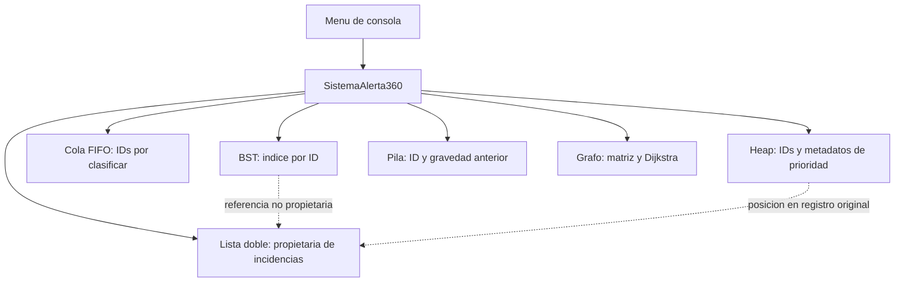

# Alerta360 - C++20

[](https://github.com/alejondr3/alerta360/actions/workflows/ci.yml)

Central de incidencias tecnicas de campus por consola. Implementa lista doble,
cola enlazada, BST, heap maximo, pila enlazada y grafo ponderado con Dijkstra.
Todas las estructuras obligatorias son propias. Los datos duran hasta cerrar
el programa; no se necesita base de datos.

## Compilar y ejecutar

Requisitos: compilador C++20 (GCC, Clang o MSVC). CMake 3.20 o superior es
opcional. No se necesitan bibliotecas externas.

```sh
git clone https://github.com/alejondr3/alerta360.git
cd alerta360
```

Desde esta carpeta, con GCC/MinGW que soporte C++20:

```powershell
g++ -std=c++20 -Wall -Wextra -pedantic *.cpp -o alerta360.exe
./alerta360.exe
```

En Linux/macOS:

```sh
g++ -std=c++20 -Wall -Wextra -pedantic *.cpp -o alerta360
./alerta360
```

Los binarios generados se excluyen del repositorio. El ZIP entregado en el chat
tambien incluye un ejecutable Windows con los runtimes de GCC enlazados
estaticamente. Se recomienda recompilar el codigo en el equipo de la defensa.
Los archivos de texto se guardan en UTF-8. Para usar acentos en una consola
Windows antigua, ejecutar `chcp 65001` antes de iniciar.

### Con CMake y CTest

```sh
cmake -S . -B build
cmake --build build --config Debug
ctest --test-dir build -C Debug --output-on-failure
```

En Linux o con MinGW, ejecutar `./build/alerta360` (en Windows, `.exe`).
Con Visual Studio, ejecutar `./build/Debug/alerta360.exe`. Para usar MinGW
explicitamente: `cmake -S . -B build -G "MinGW Makefiles"`.

Con Make en Linux/macOS: `make`, `make test` y `make clean`.
Con MinGW: `mingw32-make`, `mingw32-make test`.

### Ejemplo rapido

Registrar ID 101, tipo 1, descripcion `Falla electrica en coliseo` y zona 3.
Clasificarlo con gravedad 5, asignarlo y resolverlo. El programa debe mostrar:

```text
Asignada 101. Ruta: 0 -> 2 -> 1 -> 3; costo 8 min.
Resuelta 101; conservada en historial.
```

## Menu

| Opcion | Operacion |
| --- | --- |
| 01 | Registrar: ID positivo unico, tipo 1-6, descripcion 10-120 caracteres y zona 1-7. |
| 02 | Clasificar la siguiente RECIBIDA; omite canceladas y solicita gravedad 1-5. |
| 03 | Cambiar gravedad de una PENDIENTE; conserva el valor anterior en la pila. |
| 04 | Deshacer la ultima correccion; descarta solo esa entrada si ya no es PENDIENTE. |
| 05 | Asignar la de mayor gravedad, con desempate por antiguedad, y registrar ruta. |
| 06 | Resolver una ASIGNADA. |
| 07 | Cancelar una RECIBIDA o PENDIENTE. |
| 08 | Buscar por ID usando el BST. |
| 09 | Historial adelante/atras, BST inorden, altura, conteos y proximas cinco pendientes. |
| 10 | Mostrar vias, cambiar costo/reabrir, cerrar o restaurar el ultimo costo. |
| 11 | Abrir mapa visual numerado en el navegador. |
| 12 | Vincular una incidencia con un lugar exacto del catalogo UPSA. |
| 00 | Liberar estructuras y mostrar cantidades vaciadas. |

La gravedad 5 tiene la mayor urgencia. Una asignacion sin ruta conserva la
incidencia en el heap; no intenta saltarse a la siguiente. Las rutas registradas
son historicas: no se recalculan al cambiar posteriormente el mapa. Restaurar
una via recupera su ultimo costo; cambiar su costo tambien permite reabrirla.
Solo se gestionan las conexiones del mapa inicial.

## Mapa visual numerado

El mapa se abre con la opcion **11**, o al iniciar:

```powershell
./alerta360.exe --visual
```

Funciona sin instalar bibliotecas y sin servidor web: C++ genera un archivo
`mapa_alerta360.html` con los datos de la sesion y una vista interactiva.
La consola lo actualiza despues de cada operacion y el navegador lo recarga
cada ocho segundos. El boton **Actualizar** permite hacerlo manualmente.
Al cerrar el programa queda la ultima instantanea; no permite recuperar la
sesion de incidencias. No se deben abrir dos sesiones visuales en la misma carpeta.

Dos vistas:

- **Campus UPSA:** diez areas numeradas (Bloque Central, A, B, C, D, E,
  Polideportivo, Cancha de Futbol, Centro de Convenciones e Ingreso Peatonal),
  ubicaciones originales del catalogo, buscador y marcadores de incidencias.
- **Zonas de atencion 0-7:** grafo obligatorio con todas sus zonas enumeradas,
  conexiones, minutos y ruta registrada de la incidencia seleccionada.

Los numeros de area visual 1-10, los ID de lugar #1-#205 y las zonas de atencion
0-7 son identificadores diferentes y se muestran con sus respectivas etiquetas.
Las areas visuales son una agrupacion para explorar el campus: no agregan nodos
al grafo obligatorio. Los contornos del mapa agrupan puntos; no son planos de
edificios. El servidor del fondo grafico oficial no respondio al consultar;
esta version utiliza las posiciones del catalogo y no incluye ese fondo.

Para marcar un problema: registrar la incidencia normalmente, abrir el mapa,
buscar el lugar y usar **12 -> ID de incidencia -> numero del lugar**.
Ejemplos: Biblioteca #173, Coliseo Polideportivo #49, Laboratorio de Redes #131.
Un lugar sin posicion publicada (202 o 204) se rechaza para no inventar un punto.
La ubicacion exacta no modifica la zona de atencion elegida ni el calculo de
Dijkstra. La ruta del grafo no se presenta como un camino peatonal real.

La vista permite seleccionar una incidencia y consultar descripcion, estado,
gravedad, lugar, planta y ruta; filtrar por estado; y buscar un lugar por nombre,
bloque o numero. Los datos del usuario se insertan como JSON escapado y se
renderizan con `textContent`. El archivo generado contiene las descripciones
de la sesion, por eso se excluye de Git junto con su temporal.

## Grafo inicial (no dirigido)

El grafo usado por el programa es el mapa de prueba obligatorio de la consigna.
Como referencia adicional del campus real se incluye el catalogo de 205
ubicaciones extraido del [mapa interactivo oficial UPSA](https://maps.upsa.edu.bo/)
en `datos/mapa_upsa_referencia.json`. Ver `datos/LEEME.md` para su alcance.

0 Central de soporte, 1 Biblioteca, 2 Laboratorios, 3 Coliseo, 4 Residencias,
5 Cafeteria, 6 Centro de salud universitario, 7 Estadio.

| Via | Minutos | Via | Minutos |
| --- | ---: | --- | ---: |
| 0-1 | 4 | 0-2 | 2 |
| 1-2 | 1 | 1-3 | 5 |
| 2-3 | 8 | 2-4 | 10 |
| 3-4 | 2 | 3-5 | 6 |
| 4-5 | 3 | 4-6 | 1 |
| 5-7 | 4 | 6-7 | 2 |

Rutas de control: `0 -> 2 -> 1 -> 3`, costo 8;
`0 -> 2 -> 1 -> 3 -> 4 -> 6 -> 7`, costo 13.
Diagonal 0; ausencia/cierre de via -1. Dijkstra usa long long para evitar
desbordamientos al sumar varios costos int positivos.

## Organizacion y memoria

```text
alerta360/
  main.cpp                   Menu y entrada de datos
  Incidencia.h               Modelo de dominio
  Estructuras.h/.cpp         Lista, cola, BST, heap y pila
  GrafoCampus.h/.cpp         Mapa y Dijkstra
  SistemaAlerta360.h/.cpp    Reglas y coordinacion
  Pruebas.cpp                Suite automatica
  pruebas/                   Entradas, matriz y evidencia
  datos/                     Catalogo de referencia UPSA
  CMakeLists.txt              Compilacion y CTest
  Makefile                   Compilacion alternativa
  .github/workflows/ci.yml   Verificacion automatica
  uso_IA.txt                 Declaracion de asistencia
```



- `Incidencia.h`: dominio, estados, tipos y ruta de hasta ocho nodos.
- `Estructuras.h/.cpp`: lista, cola, indice BST, heap y pila.
- `GrafoCampus.h/.cpp`: matriz 8x8 y Dijkstra con reconstruccion de camino.
- `SistemaAlerta360.h/.cpp`: reglas, coordinacion, consultas e invariantes.
- `main.cpp`: entrada validada, menu y manejo de EOF.
- `Pruebas.cpp`: 25 escenarios reproducibles con verificaciones automaticas.
- `MapaVisual.h/.cpp` y `MapaPlantilla.inc`: exportacion y vista interactiva.
- `UbicacionesCampus.h/.cpp`: catalogo compilado de los 205 lugares UPSA.

La lista es la unica propietaria de los registros. El BST guarda punteros no
propietarios. Cola y pila guardan IDs. Cada entrada del heap guarda ID,
metadatos de prioridad y un puntero no propietario al campo `posicionHeap` del
registro. No hay copias completas de incidencias. Las gravedades del registro
y del heap se actualizan juntas mediante `cambiarGravedad`.

El campo de posicion permite retirar o reajustar una incidencia conocida sin
buscar linealmente en el heap. Cada intercambio actualiza las posiciones.
La lista no elimina incidencias individuales: canceladas y resueltas conservan
sus direcciones hasta el cierre. Heap y BST se vacian antes de liberar la lista.
Los destructores tambien limpian al terminar por excepcion. No se permite
copiar las clases propietarias para evitar double free. El cierre es idempotente.

Invariantes: enlaces dobles reciprocos; IDs unicos; BST apunta al original;
cola contiene RECIBIDAS y canceladas aun no descartadas; heap contiene todas y
solo las PENDIENTES, una vez cada una; padre con prioridad mayor o igual a hijos;
solo ASIGNADAS/RESUELTAS tienen ruta. `validarConsistencia()` verifica estas
condiciones en pruebas y no se ejecuta en cada accion del menu.

## Complejidad

n = incidencias; p = pendientes; h = altura BST; V = zonas; k = resultados.

| Operacion | Tiempo | Espacio auxiliar |
| --- | --- | --- |
| Insertar al final de lista | O(1) | O(1) por nodo |
| Buscar por recorrido de lista | O(n) | O(1) |
| Encolar / desencolar | O(1) | O(1) por nodo |
| Insertar / buscar BST | O(h), peor O(n) | O(1), implementacion iterativa |
| Registrar (incluye validar ID e insertar BST) | O(h + longitud descripcion) | O(longitud descripcion) |
| Insertar heap | O(log p) amortizado | O(p) al ampliar arreglo |
| Extraer / retirar / cambiar prioridad heap | O(log p) | O(1) |
| Cambiar gravedad o cancelar por ID | O(h + log p) | O(1) |
| Apilar / desapilar | O(1) | O(1) por nodo |
| Deshacer | O(h + log p) | O(1) |
| Dijkstra con matriz | O(V^2) | O(V) |
| Asignar | O(h + V^2 + log p) | O(V) |
| Proximos k sin modificar heap | O(p + k log p) | O(p) |
| Recorrido/altura BST | O(n) | O(h) por recursion |
| Validacion global de diagnostico | O(n^2 + n*h + V^2) | O(h) |

La ampliacion geometrica del arreglo del heap cuesta O(p) en esa insercion
particular; por eso la insercion se expresa como amortizada. Clasificar puede
ademas descartar c IDs cancelados y hacer c busquedas BST. El espacio total es
O(n + p + q + u + V^2), con q IDs en cola y u correcciones en pila. El BST no se
autobalancea; las inserciones ordenadas lo degeneran. Altura, inorden y validacion
del BST son recursivos: un arbol extremadamente grande y degenerado puede agotar
la pila de llamadas. Su destructor es iterativo.

## Pruebas

```powershell
./alerta360.exe --pruebas
./alerta360.exe --pruebas | Set-Content -Encoding utf8 pruebas/resultados.txt
Get-Content pruebas/entrada_aceptacion.txt | ./alerta360.exe
Get-Content pruebas/entrada_invalidas.txt | ./alerta360.exe
```

En Linux/macOS se puede usar redireccion con `< archivo.txt` y `> salida.txt`.
La suite ejecuta 25 escenarios y devuelve 0 si todos pasan, 1 si alguno falla. Las pruebas
T01-T10 siguen la secuencia oficial; las restantes cubren casos adversos,
memoria, prioridades, consultas, BST, UTF-8 y costos grandes. Ver `pruebas/CASOS.md`.
La evidencia incluida se obtuvo con GCC 15.1.0 en Windows y advertencias activas.
La prueba de destruccion repetida no sustituye un detector de fugas de memoria.

GitHub Actions compila y ejecuta CTest en Linux y Windows en cada push y pull
request. En Linux tambien habilita AddressSanitizer y UndefinedBehaviorSanitizer.
El estado de cada ejecucion se consulta en la pestana Actions.

En un entorno GCC/Clang con soporte de sanitizadores:

```sh
g++ -std=c++20 -Wall -Wextra -pedantic -g -fsanitize=address,undefined -fno-omit-frame-pointer *.cpp -o alerta360_asan
./alerta360_asan --pruebas
```

## Alcance de esta entrega de codigo

El repositorio incluye fuentes, instrucciones, configuracion de compilacion,
datos y evidencia de pruebas. El ejecutable se genera localmente.
El informe institucional PDF de 5-8 paginas no forma parte de esta entrega de
codigo. Para la entrega academica deben completarse integrantes/grupo, informe
y preparacion de defensa. La asistencia de IA se declara en `uso_IA.txt`.
