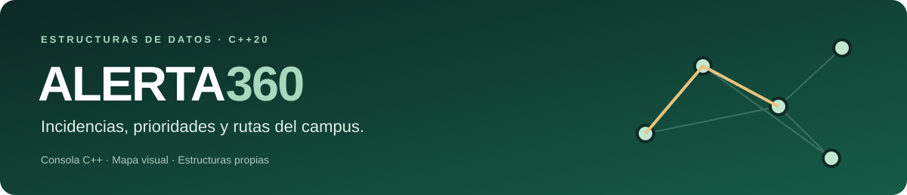
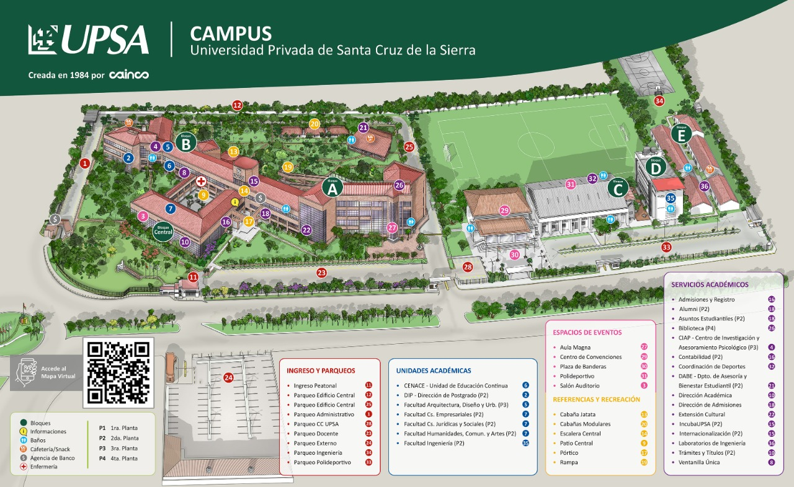
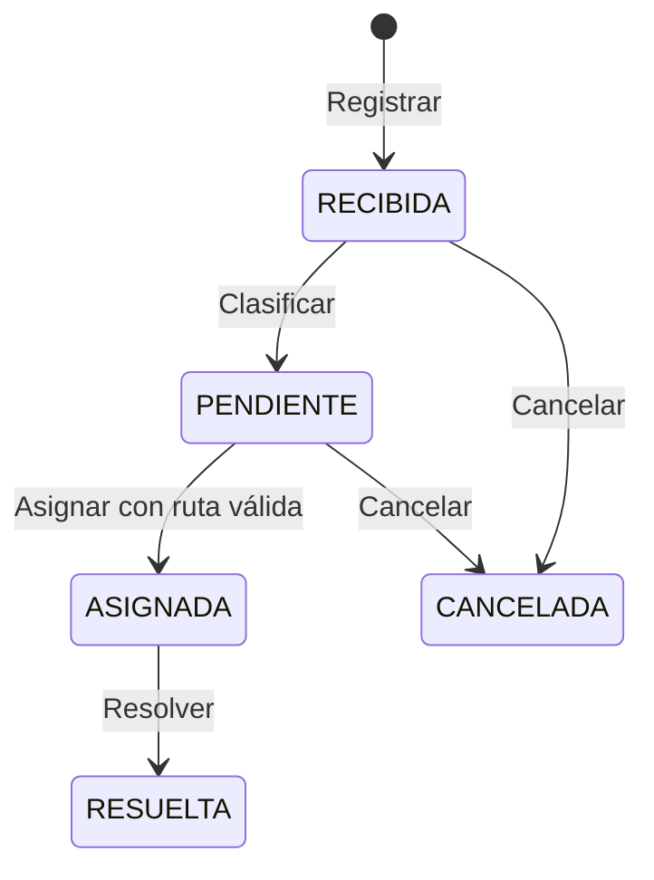

<p align="center">
  
</p>

<div align="center">

# Alerta360

**Del reporte a la resolución, con prioridad y ubicación.**

Central de incidencias técnicas de campus desarrollada en C++20, con estructuras de datos propias y un mapa visual de la UPSA.

[](https://github.com/alejondr3/alerta360/actions/workflows/ci.yml)


[Inicio rápido](#inicio-rápido) · [Mapa del campus](#mapa-del-campus) · [Arquitectura](#arquitectura) · [Pruebas](#pruebas) · [Documentación](#documentación)

</div>

---

## Qué hace

Alerta360 recibe fallas de energía, red, equipos, climatización e infraestructura. Las clasifica, ordena su atención por urgencia, calcula una ruta de asignación y conserva el historial de cada reporte durante la sesión.

| Capacidad | Comportamiento |
| :--- | :--- |
| **Recepción ordenada** | Los reportes ingresan a una cola FIFO y reciben un ID único. |
| **Atención por prioridad** | Mayor gravedad primero; ante un empate, se atiende el reporte más antiguo. |
| **Correcciones reversibles** | Los cambios de gravedad se guardan en una pila y pueden deshacerse mientras la incidencia siga pendiente. |
| **Asignación con ruta** | Dijkstra calcula el camino mínimo desde la base. Si no hay ruta, el reporte permanece pendiente. |
| **Ubicación visual** | Las incidencias se marcan sobre la imagen completa del campus, con referencias numeradas y zoom. |
| **Historial e indicadores** | Búsqueda por ID, recorridos, conteos por estado y próximas cinco incidencias sin modificar las estructuras. |

## Mapa del campus



La vista utiliza la imagen original publicada por [Postgrado UPSA](https://postgrado.upsa.edu.bo/contacto). Conserva el plano completo, sus **36 referencias**, los nombres de los bloques y las leyendas. La imagen está incorporada en el ejecutable y en el HTML generado, por lo que funciona sin conexión.

**Acercá hasta 400%, desplazá el plano y seleccioná una incidencia para consultar su estado y ubicación.** El botón **Ver completo** recupera el encuadre original.

<details>
<summary><strong>Ver captura de la aplicación con incidencias de demostración</strong></summary>

<p align="center">
  
</p>

Los marcadores rojos corresponden a datos de ejemplo identificados como **DEMO**.

</details>

### Marcar dónde está el problema

1. Registrá la incidencia desde la opción **01**.
2. Abrí el mapa con **11**.
3. Elegí **13 → ID de incidencia → número impreso en la foto**.

| Referencia de la foto | Ubicación |
| :---: | :--- |
| **26** | Biblioteca |
| **31** | Polideportivo |
| **36** | Laboratorios de Ingeniería |

La opción **12** permite usar el catálogo avanzado de **205 lugares**, con nombres, bloques y plantas.

> **Tres numeraciones, tres propósitos.** La foto usa referencias **1–36**; el catálogo, ID **1–205**; y el grafo de atención, nodos **0–7**. Una ubicación visual no cambia la zona de atención ni el cálculo de rutas. Las aulas sin referencia propia se muestran aproximadamente por bloque, con una indicación visible.

## Inicio rápido

### Requisitos

- Compilador compatible con **C++20**: GCC, Clang o MSVC.
- **CMake 3.20+**, si elegís ese método de compilación.
- Navegador para la vista del campus.

El núcleo utiliza la biblioteca estándar y las APIs del sistema para abrir el navegador. No requiere instalar paquetes externos.

```sh
git clone https://github.com/alejondr3/alerta360.git
cd alerta360
```

### Windows · GCC / MinGW

```powershell
g++ -std=c++20 -Wall -Wextra -pedantic *.cpp -o alerta360.exe
./alerta360.exe --visual
```

### Linux / macOS · GCC o Clang

```sh
g++ -std=c++20 -Wall -Wextra -pedantic *.cpp -o alerta360
./alerta360 --visual
```

Con Clang, reemplazá `g++` por `clang++`. En una consola Windows antigua, `chcp 65001` permite usar texto UTF-8.

<details>
<summary><strong>Compilar con CMake, Visual Studio o Make</strong></summary>

```sh
cmake -S . -B build
cmake --build build --config Debug
ctest --test-dir build -C Debug --output-on-failure
```

| Generador / entorno | Ejecutar el mapa con la consola |
| :--- | :--- |
| Linux / macOS, generador de una configuración | `./build/alerta360 --visual` |
| Windows con MinGW | `./build/alerta360.exe --visual` |
| Windows con Visual Studio | `./build/Debug/alerta360.exe --visual` |

Para seleccionar MinGW explícitamente, usá una carpeta de compilación nueva:

```powershell
cmake -S . -B build-mingw -G "MinGW Makefiles"
cmake --build build-mingw
```

Con Make: `make`, `make test` y `make clean`. En MinGW, usá `mingw32-make`.

</details>

### Modos de ejecución

| Argumento | Resultado |
| :--- | :--- |
| Sin argumentos | Inicia el menú de consola. |
| `--visual` | Inicia la consola y abre el mapa de la sesión. |
| `--mapa` | Genera y abre un mapa vacío, y termina. |
| `--pruebas` | Ejecuta la suite automática y devuelve su resultado. |

## Un primer recorrido

Registrá el reporte **101**, tipo **Energía**, descripción `Falla electrica en coliseo` y zona **3**. Marcá su ubicación con **13 → 101 → 31**, clasificalo con gravedad **5**, asignalo y resolvelo.

```text
Asignada 101. Ruta: 0 -> 2 -> 1 -> 3; costo 8 min.
Resuelta 101; conservada en historial.
```

El marcador se ubica en la referencia **31 · Polideportivo** de la foto. La ruta se consulta en la vista del grafo de atención.



La gravedad va de **1 a 5**, donde **5 es la mayor urgencia**. Deshacer restaura una corrección de gravedad; no retrocede el estado de la incidencia.

<details>
<summary><strong>Referencia completa del menú</strong></summary>

| Opción | Acción |
| :---: | :--- |
| **01** | Registrar una incidencia en lista, BST y cola. |
| **02** | Clasificar la siguiente recibida e insertarla en el heap. |
| **03** | Cambiar la gravedad de una pendiente. |
| **04** | Deshacer la última corrección de gravedad. |
| **05** | Asignar la siguiente por prioridad y registrar su ruta. |
| **06** | Resolver una incidencia asignada. |
| **07** | Cancelar una recibida o pendiente. |
| **08** | Buscar por ID mediante el BST. |
| **09** | Consultar historial, indicadores y próximas cinco pendientes. |
| **10** | Gestionar costos, cierres y restauraciones de vías. |
| **11** | Abrir el mapa visual. |
| **12** | Vincular un lugar del catálogo UPSA, con ID de 1 a 205. |
| **13** | Vincular una referencia de la foto, de 1 a 36. |
| **00** | Liberar las estructuras y cerrar. |

</details>

## Arquitectura

La consola y el mapa comparten los datos de una misma sesión. `SistemaAlerta360` coordina las reglas de negocio y mantiene consistentes las estructuras implementadas por el proyecto.

| Estructura propia | Responsabilidad |
| :--- | :--- |
| **Lista doblemente enlazada** | Repositorio único e historial de incidencias. |
| **Cola FIFO enlazada** | Orden de recepción para la clasificación. |
| **BST por ID** | Índice hacia los registros originales de la lista. |
| **Heap binario máximo** | Prioridad por gravedad y antigüedad. |
| **Pila LIFO enlazada** | Historial de correcciones de gravedad. |
| **Grafo ponderado + Dijkstra** | Conexiones del campus de prueba y caminos mínimos. |

La lista posee los registros. Los índices guardan referencias o IDs y no duplican incidencias completas. El heap mantiene una posición inversa para reajustar o retirar elementos conocidos en `O(log p)`.

Los detalles de memoria, invariantes y complejidad están en [Arquitectura y decisiones de diseño](docs/ARQUITECTURA.md).

### Organización del repositorio

```text
alerta360/
├── main.cpp                    # Menú y entrada validada
├── Incidencia.h                # Modelo de dominio
├── Estructuras.h/.cpp          # Lista, cola, BST, heap y pila
├── GrafoCampus.h/.cpp          # Matriz de adyacencia y Dijkstra
├── SistemaAlerta360.h/.cpp     # Reglas e integración
├── MapaVisual.h/.cpp           # Exportación y apertura del mapa
├── MapaPlantilla.inc           # Interfaz visual
├── MapaCampusImagen.inc        # JPEG incorporado al ejecutable
├── UbicacionesCampus.h/.cpp    # Catálogo y referencias del plano
├── Pruebas.cpp                 # 26 escenarios automáticos
├── pruebas/                    # Entradas, salidas y evidencias
├── datos/                      # Foto original, catálogo y fuentes
├── docs/                       # Arquitectura y recursos del README
├── .github/workflows/ci.yml    # Linux, Windows y sanitizadores
├── CMakeLists.txt
├── Makefile
└── uso_IA.txt
```

## Grafo de atención

El sistema utiliza el grafo **no dirigido de ocho nodos** definido para el proyecto. El origen fijo es **0 · Central de soporte**.

| Nodo | Zona | Nodo | Zona |
| :---: | :--- | :---: | :--- |
| 0 | Central de soporte | 4 | Residencias |
| 1 | Biblioteca | 5 | Cafetería |
| 2 | Laboratorios | 6 | Centro de salud universitario |
| 3 | Coliseo | 7 | Estadio |

<details>
<summary><strong>Conexiones, costos y rutas de control</strong></summary>

| Vía | Minutos | Vía | Minutos |
| :---: | ---: | :---: | ---: |
| 0–1 | 4 | 0–2 | 2 |
| 1–2 | 1 | 1–3 | 5 |
| 2–3 | 8 | 2–4 | 10 |
| 3–4 | 2 | 3–5 | 6 |
| 4–5 | 3 | 4–6 | 1 |
| 5–7 | 4 | 6–7 | 2 |

| Destino | Ruta mínima desde la base | Costo |
| :--- | :--- | ---: |
| Zona 3 | `0 → 2 → 1 → 3` | **8 min** |
| Zona 7 | `0 → 2 → 1 → 3 → 4 → 6 → 7` | **13 min** |

Las conexiones tienen costos positivos; la diagonal es `0` y una vía ausente o cerrada vale `-1`. Los costos acumulados se almacenan en `long long`.

</details>

Si el destino queda desconectado, la asignación se rechaza y la incidencia conserva su posición lógica como pendiente. Las rutas registradas se mantienen como historial aunque el mapa cambie después.

## Pruebas

La suite incluye **26 escenarios reproducibles**: los diez casos de aceptación del proyecto y casos adicionales de prioridad, cancelación, memoria, entradas inválidas, UTF-8, exportación segura y referencias de la foto.

```powershell
./alerta360.exe --pruebas
```

```text
=== Resumen: 26 aprobadas, 0 fallidas ===
```

El proceso devuelve `0` si todas las pruebas pasan y `1` si alguna falla. CTest agrupa los 26 escenarios en una suite.

| Verificación automática | Entorno |
| :--- | :--- |
| Compilación C++20 y suite funcional | GitHub Actions · Linux y Windows |
| AddressSanitizer y UndefinedBehaviorSanitizer | GitHub Actions · Linux |
| Entradas y salidas reproducibles del menú | Archivos de evidencia en `pruebas/` |

[Ver las ejecuciones de CI](https://github.com/alejondr3/alerta360/actions) · [Matriz de pruebas](pruebas/CASOS.md) · [Resultados](pruebas/resultados.txt) · [Registro de verificación](pruebas/VERIFICACION.txt)

<details>
<summary><strong>Reproducir sesiones y ejecutar sanitizadores localmente</strong></summary>

```powershell
Get-Content pruebas/entrada_aceptacion.txt | ./alerta360.exe
Get-Content pruebas/entrada_invalidas.txt | ./alerta360.exe
Get-Content pruebas/entrada_foto.txt | ./alerta360.exe
```

En Linux/macOS, usá `./alerta360 < pruebas/entrada_aceptacion.txt`.

Con GCC/Clang y sanitizadores disponibles en Linux/macOS:

```sh
cmake -S . -B build-asan -DCMAKE_BUILD_TYPE=Debug -DENABLE_SANITIZERS=ON
cmake --build build-asan
ctest --test-dir build-asan --output-on-failure
```

</details>

## Alcance de la sesión

- Las incidencias permanecen **en memoria** hasta cerrar el programa.
- `mapa_alerta360.html` conserva una instantánea visual; no recupera la sesión.
- Con el mapa activo, la consola regenera el HTML después de las operaciones. El navegador se actualiza cuando no se está interactuando.
- Cada sesión visual debe usar su propia carpeta para evitar compartir el mismo archivo generado.
- El grafo de prueba conserva los pesos de la consigna. Sus tiempos no representan mediciones peatonales reales sobre la fotografía.

## Documentación

| Recurso | Contenido |
| :--- | :--- |
| [Arquitectura](docs/ARQUITECTURA.md) | Componentes, propiedad de memoria, invariantes y complejidades. |
| [Pruebas y evidencias](pruebas/CASOS.md) | Escenarios, entradas y resultados esperados. |
| [Fuente del plano](datos/FUENTE_PLANO.md) | Procedencia, dimensiones y hash de la imagen original. |
| [Catálogo del campus](datos/LEEME.md) | Alcance de las ubicaciones y correspondencias con la foto. |
| [Asistencia de IA](uso_IA.txt) | Declaración del alcance de la asistencia utilizada. |

---

**Contexto académico:** proyecto integrador de Estructuras de Datos, UPSA. La implementación y la documentación del repositorio acompañan el informe y la defensa requeridos por la asignatura.

La imagen del campus pertenece a su fuente original y mantiene sus marcas y atribuciones. Su incorporación no implica que Alerta360 sea un producto oficial de la universidad.
