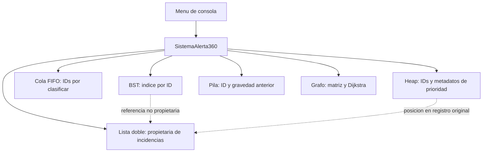

# Arquitectura y decisiones de diseño

[Volver al README](../README.md)

## Componentes y propiedad de memoria

```text
alerta360/
  main.cpp                   Menu y entrada de datos
  Incidencia.h               Modelo de dominio
  Estructuras.h/.cpp         Lista, cola, BST, heap y pila
  GrafoCampus.h/.cpp         Mapa y Dijkstra
  SistemaAlerta360.h/.cpp    Reglas y coordinacion
  Pruebas.cpp                Suite automatica
  pruebas/                   Entradas, matriz y evidencia
  datos/                     Catalogo de referencia UPSA
  CMakeLists.txt              Compilacion y CTest
  Makefile                   Compilacion alternativa
  .github/workflows/ci.yml   Verificacion automatica
  uso_IA.txt                 Declaracion de asistencia
```



- `Incidencia.h`: dominio, estados, tipos y ruta de hasta ocho nodos.
- `Estructuras.h/.cpp`: lista, cola, indice BST, heap y pila.
- `GrafoCampus.h/.cpp`: matriz 8x8 y Dijkstra con reconstruccion de camino.
- `SistemaAlerta360.h/.cpp`: reglas, coordinacion, consultas e invariantes.
- `main.cpp`: entrada validada, menu y manejo de EOF.
- `Pruebas.cpp`: 31 escenarios reproducibles con verificaciones automaticas.
- `MapaConsola.h/.cpp`: esquema ASCII, conteos e incidencias por bloque.
- `DatosJSON.h/.cpp`: serializacion independiente de la interfaz.
- `UbicacionesCampus.h/.cpp`: catalogo compilado de los 205 lugares UPSA.

La lista es la unica propietaria de los registros. El BST guarda punteros no
propietarios. Cola y pila guardan IDs. Cada entrada del heap guarda ID,
metadatos de prioridad y un puntero no propietario al campo `posicionHeap` del
registro. No hay copias completas de incidencias. Las gravedades del registro
y del heap se actualizan juntas mediante `cambiarGravedad`.

El campo de posicion permite retirar o reajustar una incidencia conocida sin
buscar linealmente en el heap. Cada intercambio actualiza las posiciones.
La lista no elimina incidencias individuales: canceladas y resueltas conservan
sus direcciones hasta el cierre. Heap y BST se vacian antes de liberar la lista.
Los destructores tambien limpian al terminar por excepcion. No se permite
copiar las clases propietarias para evitar double free. El cierre es idempotente.

Invariantes: enlaces dobles reciprocos; IDs unicos; BST apunta al original;
cola contiene RECIBIDAS y canceladas aun no descartadas; heap contiene todas y
solo las PENDIENTES, una vez cada una; padre con prioridad mayor o igual a hijos;
solo ASIGNADAS/RESUELTAS tienen ruta. `validarConsistencia()` verifica estas
condiciones en pruebas y no se ejecuta en cada accion del menu.

## Complejidad

n = incidencias; p = pendientes; h = altura BST; V = zonas; k = resultados.

| Operacion | Tiempo | Espacio auxiliar |
| --- | --- | --- |
| Insertar al final de lista | O(1) | O(1) por nodo |
| Buscar por recorrido de lista | O(n) | O(1) |
| Encolar / desencolar | O(1) | O(1) por nodo |
| Insertar / buscar BST | O(h), peor O(n) | O(1), implementacion iterativa |
| Registrar (incluye validar ID e insertar BST) | O(h + longitud descripcion) | O(longitud descripcion) |
| Insertar heap | O(log p) amortizado | O(p) al ampliar arreglo |
| Extraer / retirar / cambiar prioridad heap | O(log p) | O(1) |
| Cambiar gravedad o cancelar por ID | O(h + log p) | O(1) |
| Apilar / desapilar | O(1) | O(1) por nodo |
| Deshacer | O(h + log p) | O(1) |
| Dijkstra con matriz | O(V^2) | O(V) |
| Asignar | O(h + V^2 + log p) | O(V) |
| Proximos k sin modificar heap | O(p + k log p) | O(p) |
| Recorrido/altura BST | O(n) | O(h) por recursion |
| Validacion global de diagnostico | O(n^2 + n*h + V^2) | O(h) |

La ampliacion geometrica del arreglo del heap cuesta O(p) en esa insercion
particular; por eso la insercion se expresa como amortizada. Clasificar puede
ademas descartar c IDs cancelados y hacer c busquedas BST. El espacio total es
O(n + p + q + u + V^2), con q IDs en cola y u correcciones en pila. El BST no se
autobalancea; las inserciones ordenadas lo degeneran. Altura, inorden y validacion
del BST son recursivos: un arbol extremadamente grande y degenerado puede agotar
la pila de llamadas. Su destructor es iterativo.


## Vista visual y exportación

La consola conserva la lógica de negocio. `MapaVisual.cpp` exporta una instantánea
HTML autosuficiente con JSON escapado y la foto oficial incorporada.
`MapaPlantilla.inc` contiene la interfaz; `MapaCampusImagen.inc`, los fragmentos
base64 del JPEG original. No se requiere un servidor ni se abre un puerto.

Las referencias de la foto (1–36), los ID del catálogo (1–205) y los nodos del
grafo (0–7) son identificadores independientes. Una incidencia puede vincularse
a una referencia o a un lugar del catálogo; elegir uno retira el otro.
La posición visual no modifica los cálculos de Dijkstra.

## Costos de la vista opcional

Con el mapa activo, cada operación también regenera el HTML. Esa escritura
recorre las n incidencias e incorpora la imagen y el catálogo, cuyos tamaños
son fijos en esta versión. Las complejidades de las estructuras de la tabla
anterior describen el núcleo; la exportación agrega O(n + B) tiempo y tamaño
de salida, con B correspondiente a los recursos incorporados.

## Límites del modelo

Los registros permanecen en memoria hasta cerrar el programa. El HTML final
es una instantánea de consulta y no un archivo de recuperación. El BST es
convencional, sin balanceo automático; sus recorridos recursivos consumen O(h)
de pila. El grafo de ocho nodos corresponde a la consigna y no representa
una red peatonal medida del campus real.

## Registro simplificado por bloque y aula

`registrarAula` valida bloque, aula, ID y gravedad antes de crear el registro.
La gravedad solicitada se guarda mientras el ID atraviesa la cola FIFO; cuando
llega al frente, la clasificación automática fija la gravedad y lo inserta en
el heap. Una recibida antigua sin gravedad no se salta. El modo `--consigna`
conserva la entrada y clasificación originales.

El valor interno `zona = -1` identifica un reporte por bloque/aula que todavía
no tiene correspondencia con el grafo. Se admite solo con ambos campos válidos.
La asignación lo rechaza sin extraerlo del heap, hasta configurar sus rutas
con el nuevo mapa. Bloque y aula se exportan como JSON escapado y no se usan
como coordenadas sobre el plano anterior.

## Catalogo docente y vista por planta

Cada ubicacion conserva una marca `docente` segun `cat-classrooms` en la fuente.
Se publican 122 entradas de esa categoria, 72 con la palabra Aula. El resto
incluye laboratorios, salas y talleres; no se interpreta como 122 aulas.
`buscarAulaCampus` reconoce codigos de sala y comprueba que pertenezcan al
bloque indicado. El alta vincula el ID del catalogo sin modificar el grafo.
La interfaz filtra por bloque y planta y presenta tarjetas de espacios; no
reconstruye habitaciones o pasillos interiores a partir de la foto exterior.

El fondo original permanece incorporado y se agrega una ilustracion IA
limpiada a partir de esa imagen. Los anclajes de bloque son aproximados, no
coordenadas de aula. La seleccion del catalogo no equivale a una medicion
geografica y no produce tiempos de recorrido reales.


## Mapa de consola

`SistemaAlerta360::mostrarMapaConsola` pasa su lista como referencia constante al renderizador. El renderizador cuenta las incidencias activas (recibidas, pendientes y asignadas), agrupa por bloque y muestra el detalle en orden de ingreso. Resueltas y canceladas conservan su ficha en el historial.

Una ubicacion del catalogo elegida explicitamente prevalece sobre el bloque ingresado. Las referencias del plano sin correspondencia de bloque se listan sin inventar una posicion. La vista no modifica el heap, el BST, la cola ni los estados. Su recorrido cuesta O(n) con un catalogo fijo de 205 entradas; los seis contadores requieren O(1) memoria auxiliar. No usa HTML, imagenes incorporadas, APIs de apertura del navegador ni bibliotecas externas.

El menu normal tiene cuatro opciones y un submenu; `--consigna` conserva la numeracion academica. Los caracteres del esquema son ASCII y los nombres del catalogo se imprimen en UTF-8.
